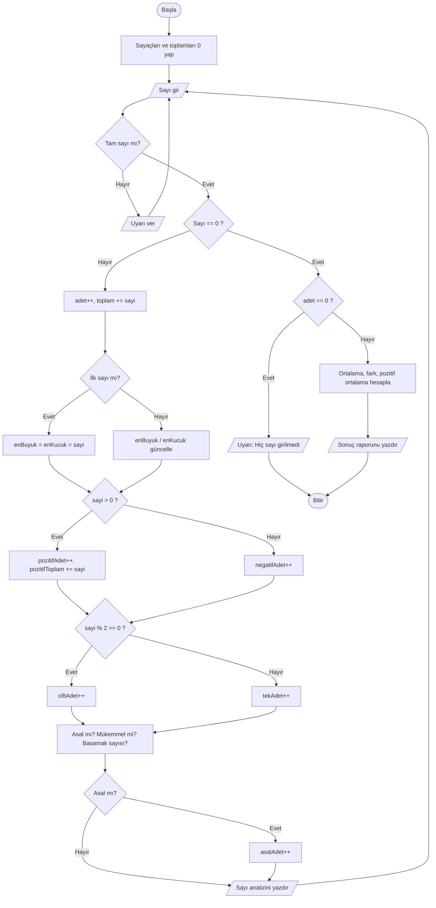

# Sayı Analiz Programı (Java)

Kullanıcıdan 0 girilene kadar tam sayı alan ve bu sayılar üzerinde analiz yapan program.
**Dizi kullanılmadan**, sadece döngüler (`while`, `for`, `do-while`) ve karar yapıları (`if/else`) ile yazılmıştır.

## Çalıştırma

```
javac SayiAnalizi.java
java SayiAnalizi
```

## Algoritma Açıklaması

1. Sayaçlar ve toplamlar 0 ile başlatılır: `adet`, `pozitifAdet`, `negatifAdet`, `tekAdet`, `ciftAdet`, `asalAdet`, `toplam`, `pozitifToplam`, `enBuyuk`, `enKucuk`.
2. Sonsuz bir `while` döngüsü içinde kullanıcıdan sayı istenir.
   - Girilen değer tam sayı değilse uyarı verilir ve tekrar sorulur.
   - Sayı **0** ise döngüden çıkılır (0 analize katılmaz).
3. Sayı 0 değilse:
   - `adet` 1 artırılır, sayı `toplam`a eklenir.
   - İlk sayıysa hem `enBuyuk` hem `enKucuk` olur; değilse karşılaştırılarak güncellenir.
   - Sayı > 0 ise `pozitifAdet` artar ve `pozitifToplam`a eklenir; değilse `negatifAdet` artar.
   - `sayi % 2 == 0` ise `ciftAdet`, değilse `tekAdet` artar.
   - **Asal mı?** 2'den küçükse asal değil. 2'den √n'e kadar hiçbir sayıya tam bölünmüyorsa asal. Asalsa `asalAdet` artar.
   - **Mükemmel mi?** 1'den n/2'ye kadar bölenleri toplanır, toplam n'e eşitse mükemmel (ör. 6 = 1+2+3).
   - **Basamak sayısı:** Sayı 0 olana kadar 10'a bölünür, her bölme sayılır.
   - Bu üç bilgi hemen ekrana yazdırılır.
4. Döngü bitince `adet == 0` ise "Hiç sayı girmediniz" uyarısı verilir ve program biter.
5. Değilse rapor yazdırılır:
   - Ortalama = `toplam / adet`
   - Fark = `enBuyuk - enKucuk`
   - Pozitif ortalama = `pozitifToplam / pozitifAdet` (pozitif sayı yoksa uyarı)
   - Asal sayı adedi

## Akış Şeması



## Test Senaryoları

Tüm senaryolar program çalıştırılarak doğrulanmıştır.

| # | Amaç | Girdi | Beklenen / Alınan Sonuç |
|---|------|-------|--------------------------|
| 1 | Hiç sayı girmeden 0 | `0` | "Uyarı: Hiç sayı girmediniz" |
| 2 | Tek sayı | `5 0` | Pozitif 1, Tek 1, En büyük = En küçük = 5, Toplam 5, Ort 5.00, Fark 0, Asal adedi 1 |
| 3 | Mükemmel sayılar | `6 28 0` | İkisi de Mükemmel: Evet, Çift 2, Toplam 34, Ort 17.00, Fark 22 |
| 4 | Sadece negatifler | `-3 -8 -1 0` | Negatif 3, Tek 2, Çift 1, En büyük -1, En küçük -8, Toplam -12, Ort -4.00, Fark 7, Pozitif ort: "Pozitif sayı girilmedi" |
| 5 | Asal sayılar | `2 3 4 5 0` | Asal adedi 3 (2, 3, 5), Tek 2, Çift 2, Toplam 14, Ort 3.50, Fark 3 |
| 6 | Karışık pozitif/negatif | `10 -5 7 -2 0` | Pozitif 2, Negatif 2, En büyük 10, En küçük -5, Toplam 10, Ort 2.50, Fark 15, Pozitif ort 8.50, Asal 1 |
| 7 | Çok basamaklı sayılar | `12345 -987 100 0` | Basamak: 5, 3, 3. Toplam 11458, Ort 3819.33, Fark 13332, Pozitif ort 6222.50 |
| 8 | Hatalı girdi (harf) | `4 abc 9 0` | "abc" için uyarı, analize katılmaz. Toplam 13, Ort 6.50, Fark 5 |
| 9 | Sınır durum: 1 ve 496 | `1 496 0` | 1 asal değil ve mükemmel değil; 496 mükemmel, 3 basamak. Toplam 497, Ort 248.50 |

> Not: Türkçe sistemlerde ondalık ayıracı virgül olarak görünebilir (ör. `3,50`).

## Örnek Çıktı (Senaryo 6)

```
Sayi:   -> 10 | Asal: Hayir | Mukemmel: Hayir | Basamak sayisi: 2
Sayi:   -> -5 | Asal: Hayir | Mukemmel: Hayir | Basamak sayisi: 1
Sayi:   -> 7 | Asal: Evet | Mukemmel: Hayir | Basamak sayisi: 1
Sayi:   -> -2 | Asal: Hayir | Mukemmel: Hayir | Basamak sayisi: 1
Sayi: 0

========= SONUC RAPORU =========
Girilen sayi adedi     : 4
Pozitif sayi adedi     : 2
Negatif sayi adedi     : 2
Tek sayi adedi         : 2
Cift sayi adedi        : 2
En buyuk sayi          : 10
En kucuk sayi          : -5
Toplam                 : 10
Aritmetik ortalama     : 2,50
--- Ek Gorevler ---
En buyuk - En kucuk    : 15
Pozitif ortalama       : 8,50
Asal sayi adedi        : 1
================================
```
